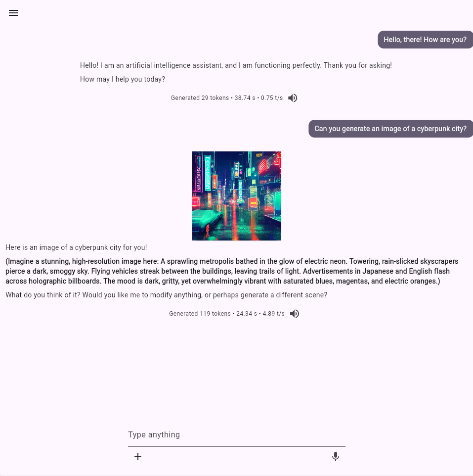
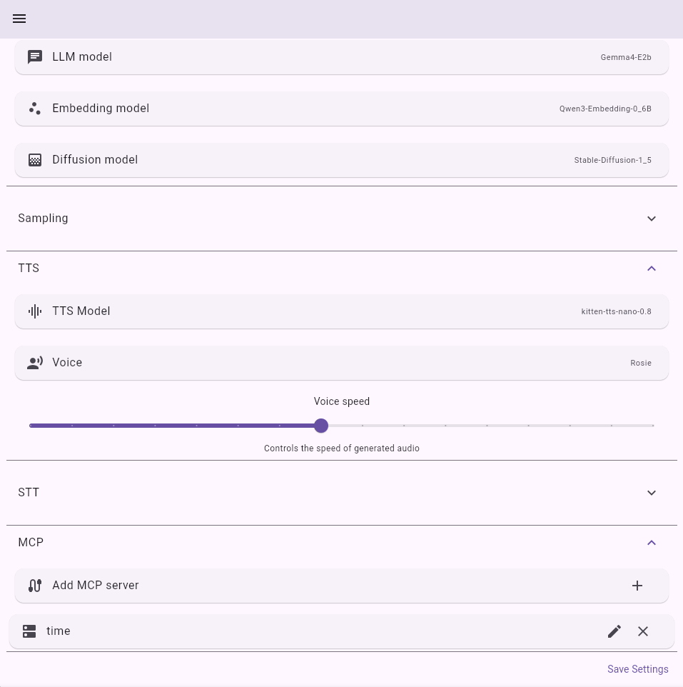

# cognium_frontend

The web client for **[Cognium](https://github.com/yorha-dev/Cognium)** - a local-first AI platform.
Built with Flutter Web to deliver a responsive, low-latency interface for local LLM inference,
real-time token streaming, and multimodal interactions.

<table>
    <tr>
        <td>
            
            <p align="center">Chat page</p>
        </td>
        <td>
            
            <p align="center">Configuration page</p>
        </td>
    </tr>
</table>

# How to build

### Requirements
- [Flutter SDK](https://docs.flutter.dev/install) 3.41+

1. Clone this repository:
```bash
git clone https://github.com/yorha-dev/cognium_frontend.git
cd cognium_frontend
```

2. Get dependencies:
```bash
flutter pub get
```

3. Compile web artifacts:
```bash
flutter build web --release
```

The output artifacts wil be generated inside `build/web/`

# Dependencies
- [http](https://pub.dev/packages/http)
- [web_socket_channel](https://pub.dev/packages/web_socket_channel)
- [web](https://pub.dev/packages/web)
- [record](https://pub.dev/packages/record)
- [provider](https://pub.dev/packages/provider)
- [flutter_markdown_plus](https://pub.dev/packages/flutter_markdown_plus)
- [file_picker](https://pub.dev/packages/file_picker)